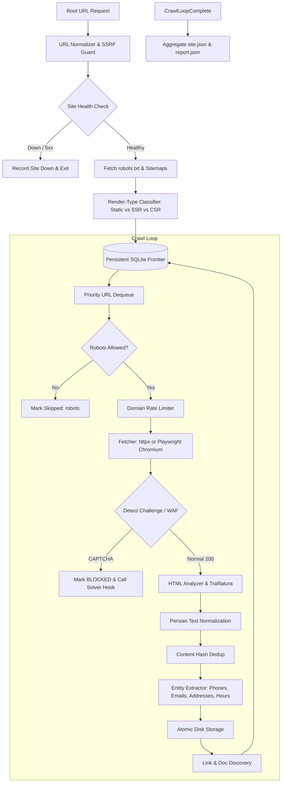

# Sprawler 🕷️

> **Production-Grade Business-Knowledge Web Crawler & Spider for Persian & International Sites (Optimized for RAG)**

[](https://www.python.org/)
[](https://fastapi.tiangolo.com)
[](https://playwright.dev/)
[](https://www.docker.com/)
[](LICENSE)

Sprawler is an asynchronous, resilient web crawler engineered to extract **business intelligence** (what a company does, services, team, addresses, Iranian phone numbers, operating hours, FAQs, policies, and articles) while **skipping e-commerce product catalogs and pagination loops**.

---

## 🌟 Key Features

- **Business Knowledge Focus:** Discovers and prioritizes about, contact, FAQ, services, and policies pages while discarding paginated listings (`?page=2`, `/page/2`) and product detail/cart pages.
- **Render-Type Detection (Static / SSR / CSR):** Heuristic detector determines whether pages are Static, SSR (Next.js/Nuxt), or CSR (SPAs). Uses fast `httpx` for static sites and Playwright headless Chromium with `networkidle` and DOM-stability observers for CSR.
- **Persian Text Normalization:** Comprehensive, pure-Python pipeline unifying Arabic letters (`ي`/`ك` ➔ `ی`/`ک`), stripping tatweel (`ـ`) and harakat diacritics, standardizing ZWNJ (half-spaces), converting numerals, and cleaning bidirectional marks.
- **Iranian Business Entity Extraction:** Rule-based extraction (zero LLM latency/cost) for Iranian mobiles (`+989...`), landlines with city prefixes (`021...`), emails, working hours, Google Maps coordinates, and social media channels.
- **Resilience & Politeness:**
  - Circuit Breaker (`CLOSED` ➔ `OPEN` ➔ `HALF_OPEN`) per host.
  - Per-domain rate limiting honoring `Crawl-delay` and politeness intervals.
  - Exponential backoff with randomized jitter for transient network glitches.
- **Persistent Frontier:** SQLite-backed queue with priority scoring, URL deduplication, depth bounds, and automatic crash recovery (resumes stale in-progress URLs).
- **Security & Safety:** Strict SSRF protection rejecting loopback, local aliases, and private RFC-1918 IPv4/IPv6 networks. Strict domain scoping prevents crawling external sites.
- **Document & PDF Processing:** Downloads linked PDF documents, extracts text via `pypdf`, and falls back to Tesseract OCR (`fas+eng`) for scanned documents.
- **FastAPI Management API:** RESTful control plane with OpenAPI Swagger docs (`/docs`) to trigger, inspect, pause, cancel, and resume crawls.

---

## 🏗️ Architecture



---

## 📁 Project Structure

```
sprawler/
├── src/crawler/
│   ├── api/                # FastAPI app, routers, schemas, healthcheck
│   ├── core/               # Pydantic settings, constants, structured logging, exceptions
│   ├── domain/             # Pydantic models (PageResult, SiteReport, SiteKnowledge) & enums
│   ├── discovery/          # Sitemap index parser (.gz), robots.txt, crt.sh, link extractor, XHR sniffer
│   ├── fetch/              # HttpFetcher, BrowserFetcher (Playwright), render_detector
│   ├── detect/             # Redirect classifier, CAPTCHA, WAF fingerprinting, site_down
│   ├── resilience/         # Domain CircuitBreaker, rate_limiter, retry with jitter
│   ├── extract/            # HTML analyzer, entity regex, page_classifier, dedup, PDF OCR
│   ├── text/               # Persian text normalization pipeline (pure functions)
│   ├── frontier/           # Persistent SQLite queue, normalizer, product/pagination filter
│   ├── storage/            # Atomic disk persistence (site.json, report.json, raw/rendered HTML)
│   ├── pipeline/           # Orchestrator and background job manager
│   ├── plugins/            # CAPTCHA solver and WAF bypass extension interfaces
│   └── main.py             # Server CLI entrypoint
├── tests/                  # Pytest unit and integration test suite
├── data/                   # Runtime per-site output directory (gitignored)
├── Dockerfile              # Container image with Playwright and Tesseract (fas+eng)
├── docker-compose.yml      # Service orchestration with 2GB shared memory
├── requirements.txt        # Pinned dependencies
├── .env.example            # Environment variable template
└── README.md
```

---

## 🚀 Quick Start

### 1. Prerequisites
- **Python 3.12**
- Git

### 2. Setup Virtual Environment
```bash
# Clone the repository
git clone https://github.com/sprawler/sprawler.git
cd sprawler

# Create and activate virtual environment
python -m venv .venv

# On Linux/macOS:
source .venv/bin/activate

# On Windows (PowerShell):
.\.venv\Scripts\Activate.ps1
```

### 3. Install Dependencies & Playwright
```bash
pip install -r requirements.txt
playwright install chromium
```

### 4. Run the API Server
```bash
uvicorn crawler.api.app:app --host 0.0.0.0 --port 8000 --reload
```
Open **[http://localhost:8000/docs](http://localhost:8000/docs)** to access the interactive Swagger UI.

---

## 🐳 Docker Deployment

Run Sprawler anywhere using Docker Compose with Playwright Chromium and Tesseract OCR (`fas+eng`) pre-installed:

```bash
docker compose up --build -d
```

Check logs:
```bash
docker compose logs -f
```

---

## 📡 API Usage & Endpoints

### 1. Start a Crawl Job
```bash
curl -X POST "http://localhost:8000/crawl" \
     -H "Content-Type: application/json" \
     -d '{
       "url": "https://plantlandtehran.com/",
       "max_pages": 50,
       "max_depth": 3,
       "allow_subdomains": true,
       "force_browser": false
     }'
```
**Response:**
```json
{
  "job_id": "7f8b9e61-a083-4a1e-bce1-3c5e8840c8f1",
  "status": "running",
  "url": "https://plantlandtehran.com/"
}
```

### 2. Check Job Status & Live Metrics
```bash
curl "http://localhost:8000/crawl/7f8b9e61-a083-4a1e-bce1-3c5e8840c8f1"
```

### 3. Retrieve Final Knowledge JSON (`site.json`)
```bash
curl "http://localhost:8000/crawl/7f8b9e61-a083-4a1e-bce1-3c5e8840c8f1/result"
```

### 4. Retrieve Coverage & Audit Report (`report.json`)
```bash
curl "http://localhost:8000/crawl/7f8b9e61-a083-4a1e-bce1-3c5e8840c8f1/report"
```

### 5. Inspect a URL Diagnostically (Zero Crawling)
```bash
curl -X POST "http://localhost:8000/analyze/url" \
     -H "Content-Type: application/json" \
     -d '{"url": "https://plantlandtehran.com/"}'
```

---

## 📂 Output Layout & Schema

Outputs are saved under `data/<sanitized-domain>/`:

```
data/plantlandtehran.com/
├── site.json                       # Comprehensive knowledge JSON for RAG
├── report.json                     # Quality and coverage audit report
├── frontier.db                     # Resumable SQLite queue
├── html/
│   ├── raw/<url_hash>.html         # HTTP response body
│   └── rendered/<url_hash>.html    # Post-JS rendered DOM
├── text/<url_hash>.txt             # Normalized clean Persian text
├── xhr/<url_hash>.json             # Captured background API payloads
├── files/                          # Downloaded PDF documents
└── logs/crawl.log                  # Rotating log file
```

### `site.json` Schema Example
```json
{
  "site": {
    "root_url": "https://plantlandtehran.com/",
    "domain": "plantlandtehran.com",
    "crawled_at": "2026-10-20T14:00:00Z",
    "status": "ok",
    "render_type": "static",
    "language": "fa",
    "waf": "none",
    "captcha": null
  },
  "business": {
    "name": "پلنت لند تهران",
    "description": "مرکز تخصصی گیاهان آپارتمانی و طراحی فضای سبز",
    "category": "services",
    "phones": [
      {"value": "+982188776655", "source_url": "https://plantlandtehran.com/contact"}
    ],
    "emails": [
      {"value": "info@plantlandtehran.com", "source_url": "https://plantlandtehran.com/contact"}
    ],
    "addresses": [
      {"value": "تهران، خیابان ولیعصر، پلاک ۱۰۰", "source_url": "https://plantlandtehran.com/contact"}
    ],
    "social": [
      {"platform": "instagram", "url": "https://instagram.com/plantlandtehran", "source_url": "https://plantlandtehran.com/"}
    ],
    "working_hours": [
      {"text": "شنبه تا چهارشنبه ۹ الی ۱۸", "source_url": "https://plantlandtehran.com/contact"}
    ],
    "geo": [
      {"latitude": 35.7219, "longitude": 51.3347, "maps_url": "https://maps.google.com/?q=35.7219,51.3347", "source_url": "https://plantlandtehran.com/contact"}
    ]
  },
  "pages": [
    {
      "url": "https://plantlandtehran.com/about-us",
      "final_url": "https://plantlandtehran.com/about-us",
      "status_code": 200,
      "redirect_chain": ["https://plantlandtehran.com/about-us"],
      "page_type": "about",
      "content_hash": "a1b2c3d4...",
      "fetched_with": "httpx",
      "html_analysis": {
        "title": "درباره پلنت لند تهران",
        "meta": {"description": "تاریخچه و ماموریت پلنت لند تهران"},
        "structured_data": [],
        "headings": [{"level": 1, "text": "درباره ما"}],
        "paragraphs": ["پلنت لند از سال ۱۳۹۵ آغاز به کار کرد..."],
        "lists": [["مشاوره تخصصی", "گیاهان وارداتی"]],
        "tables": [],
        "images": [{"src": "https://plantlandtehran.com/banner.jpg", "alt": "فضای سبز", "link_href": null, "context": "درباره ما"}],
        "links": [{"href": "https://plantlandtehran.com/contact", "text": "تماس با ما", "internal": true, "location": "footer", "wraps_image": false}],
        "text_raw": "پلنت لند از سال ۱۳۹۵ آغاز به کار کرد...",
        "text_normalized": "پلنت لند از سال 1395 آغاز به کار کرد..."
      },
      "xhr_data": [],
      "documents": []
    }
  ],
  "skipped": [
    {"url": "https://plantlandtehran.com/shop/product/123", "reason": "product"},
    {"url": "https://plantlandtehran.com/blog?page=2", "reason": "pagination"}
  ]
}
```

---

## ⚙️ Configuration Variables

| Variable | Default | Description |
| :--- | :--- | :--- |
| `SPRAWLER_MAX_CONCURRENCY` | `5` | Concurrency semaphore limit |
| `SPRAWLER_MAX_PAGES_PER_SITE` | `200` | Max page crawl limit per job |
| `SPRAWLER_MAX_DEPTH` | `4` | Maximum link depth from root URL |
| `SPRAWLER_POLITENESS_DELAY_SECONDS` | `0.5` | Minimum seconds between requests to same domain |
| `SPRAWLER_HONOR_CRAWL_DELAY` | `true` | Respect `Crawl-delay` directive in robots.txt |
| `SPRAWLER_ALLOW_SUBDOMAINS` | `true` | Include subdomains in crawl scope |
| `SPRAWLER_USE_CRTSH` | `false` | Discover subdomains via crt.sh certificate logs |
| `SPRAWLER_FORCE_BROWSER` | `false` | Always render via Playwright Chromium |
| `SPRAWLER_CIRCUIT_BREAKER_FAILURE_THRESHOLD`| `5` | Consecutive failures before tripping circuit to OPEN |
| `SPRAWLER_CIRCUIT_BREAKER_RECOVERY_TIMEOUT` | `60.0` | Cool-down seconds before testing HALF_OPEN |
| `SPRAWLER_PERSIAN_NORMALIZE_DIGITS` | `latin` | Target numeral script: `latin` (0-9), `persian` (۰-۹), or `keep` |
| `SPRAWLER_OCR_ENABLED_FOR_PDF` | `true` | Run Tesseract OCR on scanned/image-only PDFs |

---

## 🔌 Extension Points

Sprawler implements clean interface protocols for external solving services:
- **`src/crawler/plugins/captcha_solver.py`**: Implement the `CaptchaSolver` protocol (`async solve(...) -> SolveResult`) to plug in 2Captcha, CapSolver, or local models.
- **`src/crawler/plugins/waf_bypass.py`**: Implement the `WafHandler` protocol (`async handle_challenge(...) -> WafBypassResult`) to integrate FlareSolverr or residential proxy rotation.

---

## 🧪 Testing

Sprawler includes a deterministic test suite covering unit logic, regex extractors, and integration mocking:

```bash
# Run full test suite
pytest -v

# Run with coverage report
pytest --cov=crawler tests/
```

---

## 📜 Ethical Crawling & Compliance

1. **Respects `robots.txt`**: Respects `Disallow` rules and `Crawl-delay`.
2. **Domain Scoping**: Strictly confines crawler workers within the registered target domain; will never crawl external networks.
3. **SSRF Guard**: Pre-validates host resolutions to block attacks targeting local or private IP networks.

---

## 📄 License

This project is licensed under the [MIT License](LICENSE).
